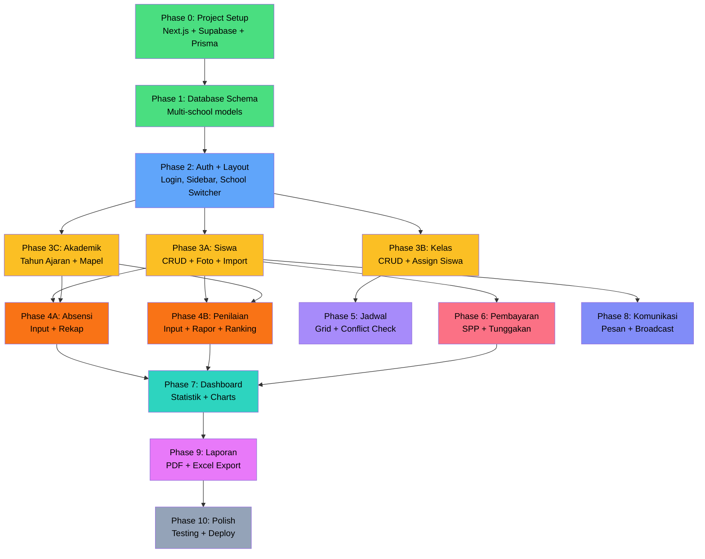

# 📋 Implementation Plan v2 — Muadalah

## Objective

Website manajemen siswa untuk **satu lembaga pendidikan** yang mengelola **beberapa sekolah** (SMP & SMA). Digunakan oleh guru, admin, dan kepala sekolah. Interface seluruhnya **Bahasa Indonesia**.

---

## Perubahan dari v1

| Aspek | v1 | v2 |
|-------|----|----|
| **Arsitektur** | React + Express (monorepo) | **Next.js App Router** (fullstack) |
| **Auth** | JWT + bcrypt manual | **Supabase Auth** |
| **Database** | PostgreSQL lokal | **Supabase PostgreSQL** |
| **Storage** | Lokal server | **Supabase Storage** |
| **Deploy** | Belum ditentukan | **Vercel** (frontend+API) + **Supabase** (DB+Auth+Storage) |
| **Scope** | Satu sekolah | **Satu Lembaga → Banyak Sekolah** |
| **Bahasa** | Belum ditentukan | **Full Bahasa Indonesia** |
| **Tingkat** | Umum | **SMP (kelas 7-9) + SMA (kelas 10-12)** |

---

## Tech Stack (Final)

| Layer | Technology | Alasan |
|-------|-----------|--------|
| **Framework** | Next.js 14+ (App Router) | Fullstack, optimal untuk Vercel |
| **Language** | TypeScript (strict) | Type safety end-to-end |
| **Styling** | Tailwind CSS + shadcn/ui | Rapid development, accessible components |
| **State** | TanStack Query + Zustand | Server cache + client state |
| **ORM** | Prisma | Type-safe queries, migrations |
| **Database** | Supabase PostgreSQL | Managed, free tier generous |
| **Auth** | Supabase Auth | Built-in, email+password, RBAC via metadata |
| **Storage** | Supabase Storage | Foto siswa, file upload |
| **Validation** | Zod | Schema validation shared |
| **Charts** | Recharts | Dashboard visualisasi |
| **Export** | jsPDF + ExcelJS | Generate PDF rapor & Excel laporan |
| **Testing** | Vitest + Playwright | Unit + E2E |
| **Deploy** | Vercel + Supabase | Auto-deploy, serverless |

---

## Arsitektur Proyek

```
Muadalah/
├── src/
│   ├── app/                           # Next.js App Router
│   │   ├── (auth)/                    # Auth layout group
│   │   │   ├── login/page.tsx
│   │   │   └── layout.tsx
│   │   ├── (dashboard)/               # Protected layout group
│   │   │   ├── layout.tsx             # Sidebar + Header layout
│   │   │   ├── page.tsx               # Dashboard home
│   │   │   ├── siswa/                 # Manajemen Siswa
│   │   │   │   ├── page.tsx           # List siswa
│   │   │   │   ├── [id]/page.tsx      # Detail siswa
│   │   │   │   └── tambah/page.tsx    # Form tambah siswa
│   │   │   ├── absensi/               # Absensi
│   │   │   │   ├── page.tsx           # Input absensi harian
│   │   │   │   └── rekap/page.tsx     # Rekap kehadiran
│   │   │   ├── nilai/                 # Penilaian
│   │   │   │   ├── page.tsx           # Input nilai
│   │   │   │   ├── rapor/[id]/page.tsx
│   │   │   │   └── ranking/page.tsx
│   │   │   ├── jadwal/                # Jadwal
│   │   │   │   └── page.tsx
│   │   │   ├── kelas/                 # Manajemen Kelas
│   │   │   │   ├── page.tsx
│   │   │   │   └── [id]/page.tsx
│   │   │   ├── pembayaran/            # SPP
│   │   │   │   ├── page.tsx
│   │   │   │   └── tunggakan/page.tsx
│   │   │   ├── komunikasi/            # Pesan Guru-Ortu
│   │   │   │   └── page.tsx
│   │   │   ├── laporan/               # Laporan & Export
│   │   │   │   └── page.tsx
│   │   │   └── pengaturan/            # Settings
│   │   │       ├── page.tsx
│   │   │       ├── sekolah/page.tsx
│   │   │       ├── tahun-ajaran/page.tsx
│   │   │       └── mata-pelajaran/page.tsx
│   │   ├── api/                       # API Routes (Route Handlers)
│   │   │   ├── auth/
│   │   │   ├── siswa/
│   │   │   ├── absensi/
│   │   │   ├── nilai/
│   │   │   ├── jadwal/
│   │   │   ├── kelas/
│   │   │   ├── pembayaran/
│   │   │   ├── pesan/
│   │   │   ├── laporan/
│   │   │   └── pengaturan/
│   │   ├── layout.tsx                 # Root layout
│   │   └── globals.css
│   │
│   ├── components/                    # React Components
│   │   ├── ui/                        # shadcn/ui base components
│   │   │   ├── button.tsx
│   │   │   ├── input.tsx
│   │   │   ├── table.tsx
│   │   │   ├── dialog.tsx
│   │   │   ├── select.tsx
│   │   │   ├── card.tsx
│   │   │   └── ...
│   │   ├── layout/                    # Layout components
│   │   │   ├── sidebar.tsx
│   │   │   ├── header.tsx
│   │   │   ├── breadcrumb.tsx
│   │   │   └── school-switcher.tsx    # Switch antar sekolah
│   │   └── shared/                    # Business components
│   │       ├── data-table.tsx         # Reusable data table
│   │       ├── stat-card.tsx          # Dashboard stat card
│   │       ├── chart-wrapper.tsx
│   │       ├── file-upload.tsx
│   │       └── empty-state.tsx
│   │
│   ├── lib/                           # Utilities
│   │   ├── supabase/
│   │   │   ├── client.ts              # Browser Supabase client
│   │   │   ├── server.ts              # Server-side Supabase client
│   │   │   └── middleware.ts          # Auth middleware
│   │   ├── prisma.ts                  # Prisma client singleton
│   │   ├── utils.ts                   # Helper functions
│   │   └── constants.ts              # App constants
│   │
│   ├── hooks/                         # Custom React hooks
│   │   ├── use-auth.ts
│   │   ├── use-school.ts             # Current school context
│   │   └── use-academic-year.ts
│   │
│   ├── stores/                        # Zustand stores
│   │   ├── auth-store.ts
│   │   └── app-store.ts              # Selected school, academic year
│   │
│   ├── types/                         # TypeScript types
│   │   ├── database.ts               # Prisma-generated types
│   │   ├── api.ts                    # API request/response types
│   │   └── enums.ts                  # Indonesian enum labels
│   │
│   └── validators/                    # Zod schemas
│       ├── siswa.ts
│       ├── absensi.ts
│       ├── nilai.ts
│       └── ...
│
├── prisma/
│   ├── schema.prisma
│   ├── migrations/
│   └── seed.ts
│
├── public/                            # Static assets
├── tests/                             # Test files
│   ├── unit/
│   ├── integration/
│   └── e2e/
│
├── next.config.ts
├── tailwind.config.ts
├── tsconfig.json
├── package.json
├── .env.local.example
└── README.md
```

---

## Database Schema (Multi-School)

### Architecture: Satu Lembaga → Banyak Sekolah

```mermaid
erDiagram
    Institution ||--|{ School : "memiliki"
    School ||--|{ Class : "memiliki"
    School ||--|{ SchoolUser : "memiliki"
    User ||--|{ SchoolUser : "terdaftar di"
    
    Class ||--|{ Student : "berisi"
    Class ||--|{ Schedule : "memiliki jadwal"
    Class ||--|{ ClassSubject : "memiliki mapel"
    
    Student ||--|{ Attendance : "memiliki absensi"
    Student ||--|{ Grade : "memiliki nilai"
    Student ||--|{ Payment : "memiliki pembayaran"
    Student ||--|{ ParentContact : "memiliki kontak ortu"
    
    Subject ||--|{ ClassSubject : "diajarkan di"
    Subject ||--|{ Grade : "dinilai di"
    Subject ||--|{ Schedule : "dijadwalkan di"
    
    AcademicYear ||--|{ Semester : "memiliki"
    Semester ||--|{ Grade : "nilai pada"
    Semester ||--|{ Attendance : "absensi pada"
    
    ParentContact ||--|{ Message : "menerima"
    User ||--|{ Message : "mengirim"
```

### Prisma Schema

```prisma
// ==================== MULTI-SCHOOL ====================

model Institution {
  id        String   @id @default(cuid())
  name      String   // "Yayasan Pendidikan Muadalah"
  address   String?
  phone     String?
  email     String?
  logo      String?  // URL di Supabase Storage
  
  schools   School[]
  createdAt DateTime @default(now())
  updatedAt DateTime @updatedAt
}

model School {
  id              String      @id @default(cuid())
  name            String      // "SMP Muadalah" / "SMA Muadalah"
  level           SchoolLevel // SMP / SMA
  address         String?
  phone           String?
  npsn            String?     @unique // Nomor Pokok Sekolah Nasional
  
  institutionId   String
  institution     Institution @relation(fields: [institutionId], references: [id])
  
  classes         Class[]
  schoolUsers     SchoolUser[]
  academicYears   AcademicYear[]
  subjects        Subject[]
  paymentSettings PaymentSetting[]
  createdAt       DateTime    @default(now())
  updatedAt       DateTime    @updatedAt

  @@index([institutionId])
}

enum SchoolLevel {
  SMP
  SMA
}

// ==================== USER & ROLES ====================

model User {
  id            String       @id @default(cuid())
  supabaseId    String       @unique  // Supabase Auth UID
  email         String       @unique
  name          String
  phone         String?
  avatar        String?      // URL di Supabase Storage
  isActive      Boolean      @default(true)
  lastLoginAt   DateTime?
  createdAt     DateTime     @default(now())
  updatedAt     DateTime     @updatedAt

  schoolUsers   SchoolUser[]
  sentMessages  Message[]    @relation("PengirimPesan")

  @@index([supabaseId])
}

model SchoolUser {
  id        String   @id @default(cuid())
  role      UserRole
  
  userId    String
  user      User     @relation(fields: [userId], references: [id])
  
  schoolId  String
  school    School   @relation(fields: [schoolId], references: [id])

  homeClasses       Class[]        @relation("WaliKelas")
  taughtSubjects    ClassSubject[]
  attendanceRecords Attendance[]   @relation("PencatatAbsensi")
  createdAt         DateTime       @default(now())

  @@unique([userId, schoolId])
  @@index([schoolId])
}

enum UserRole {
  SUPER_ADMIN   // Admin lembaga (akses semua sekolah)
  ADMIN         // Admin sekolah
  KEPALA_SEKOLAH
  GURU
}

// ==================== AKADEMIK ====================

model AcademicYear {
  id        String   @id @default(cuid())
  name      String   // "2025/2026"
  startDate DateTime
  endDate   DateTime
  isActive  Boolean  @default(false)
  
  schoolId  String
  school    School   @relation(fields: [schoolId], references: [id])
  
  semesters Semester[]
  createdAt DateTime @default(now())

  @@unique([schoolId, name])
  @@index([schoolId, isActive])
}

model Semester {
  id             String       @id @default(cuid())
  name           String       // "Ganjil" / "Genap"
  number         Int          // 1 or 2
  startDate      DateTime
  endDate        DateTime
  isActive       Boolean      @default(false)
  
  academicYearId String
  academicYear   AcademicYear @relation(fields: [academicYearId], references: [id])
  
  grades         Grade[]
  attendances    Attendance[]

  @@unique([academicYearId, number])
}

model Subject {
  id          String   @id @default(cuid())
  code        String   // "MTK", "BIN", "BIG"
  name        String   // "Matematika"
  description String?
  
  schoolId    String
  school      School   @relation(fields: [schoolId], references: [id])
  
  classSubjects ClassSubject[]
  schedules     Schedule[]
  grades        Grade[]
  createdAt     DateTime @default(now())

  @@unique([schoolId, code])
}

// ==================== KELAS ====================

model Class {
  id            String   @id @default(cuid())
  name          String   // "7A", "8B", "10-IPA-1", "12-IPS-2"
  grade         Int      // 7-9 (SMP), 10-12 (SMA)
  major         String?  // null (SMP), "IPA"/"IPS"/"Bahasa" (SMA kelas 11-12)
  
  schoolId      String
  school        School   @relation(fields: [schoolId], references: [id])
  
  homeroomTeacherId String?
  homeroomTeacher   SchoolUser? @relation("WaliKelas", fields: [homeroomTeacherId], references: [id])
  
  students      Student[]
  subjects      ClassSubject[]
  schedules     Schedule[]
  createdAt     DateTime @default(now())
  updatedAt     DateTime @updatedAt

  @@unique([schoolId, name, grade])
  @@index([schoolId, grade])
}

model ClassSubject {
  id        String     @id @default(cuid())
  
  classId   String
  class     Class      @relation(fields: [classId], references: [id])
  
  subjectId String
  subject   Subject    @relation(fields: [subjectId], references: [id])
  
  teacherId String
  teacher   SchoolUser @relation(fields: [teacherId], references: [id])

  @@unique([classId, subjectId])
}

// ==================== SISWA ====================

model Student {
  id         String        @id @default(cuid())
  nis        String        // Nomor Induk Siswa (unique per school)
  nisn       String?       // Nomor Induk Siswa Nasional
  name       String
  gender     Gender
  birthPlace String?
  birthDate  DateTime?
  religion   String?
  address    String?
  phone      String?
  photo      String?       // URL di Supabase Storage
  enrollDate DateTime      @default(now())
  status     StudentStatus @default(AKTIF)
  
  classId    String
  class      Class    @relation(fields: [classId], references: [id])
  
  attendances    Attendance[]
  grades         Grade[]
  payments       Payment[]
  parentContacts ParentContact[]
  createdAt      DateTime @default(now())
  updatedAt      DateTime @updatedAt

  @@unique([classId, nis])
  @@index([classId])
  @@index([status])
  @@index([name])
}

enum Gender {
  LAKI_LAKI
  PEREMPUAN
}

enum StudentStatus {
  AKTIF
  LULUS
  PINDAH
  KELUAR
}

// ==================== ABSENSI ====================

model Attendance {
  id           String           @id @default(cuid())
  date         DateTime         @db.Date
  status       AttendanceStatus
  notes        String?
  
  studentId    String
  student      Student    @relation(fields: [studentId], references: [id])
  
  semesterId   String
  semester     Semester   @relation(fields: [semesterId], references: [id])
  
  recordedById String
  recordedBy   SchoolUser @relation("PencatatAbsensi", fields: [recordedById], references: [id])
  
  createdAt    DateTime   @default(now())

  @@unique([studentId, date])
  @@index([date])
  @@index([studentId, semesterId])
}

enum AttendanceStatus {
  HADIR
  ALFA        // Tanpa keterangan
  SAKIT
  IZIN
  TERLAMBAT
}

// ==================== NILAI ====================

model Grade {
  id          String    @id @default(cuid())
  type        GradeType
  score       Float
  maxScore    Float     @default(100)
  weight      Float     @default(1)
  description String?
  date        DateTime  @default(now())
  
  studentId   String
  student     Student   @relation(fields: [studentId], references: [id])
  
  subjectId   String
  subject     Subject   @relation(fields: [subjectId], references: [id])
  
  semesterId  String
  semester    Semester  @relation(fields: [semesterId], references: [id])
  
  createdAt   DateTime  @default(now())
  updatedAt   DateTime  @updatedAt

  @@index([studentId, subjectId, semesterId])
  @@index([type])
}

enum GradeType {
  ULANGAN_HARIAN
  UTS
  UAS
  TUGAS
  PRAKTIKUM
  PROYEK
}

// ==================== JADWAL ====================

model Schedule {
  id        String    @id @default(cuid())
  dayOfWeek DayOfWeek
  startTime String    // "07:00"
  endTime   String    // "08:30"
  room      String?
  
  classId   String
  class     Class     @relation(fields: [classId], references: [id])
  
  subjectId String
  subject   Subject   @relation(fields: [subjectId], references: [id])
  
  createdAt DateTime  @default(now())

  @@index([classId, dayOfWeek])
}

enum DayOfWeek {
  SENIN
  SELASA
  RABU
  KAMIS
  JUMAT
  SABTU
}

// ==================== PEMBAYARAN ====================

model PaymentSetting {
  id       String      @id @default(cuid())
  type     PaymentType
  amount   Float       // Nominal default
  
  schoolId String
  school   School      @relation(fields: [schoolId], references: [id])

  @@unique([schoolId, type])
}

model Payment {
  id         String        @id @default(cuid())
  amount     Float
  month      Int           // 1-12
  year       Int
  type       PaymentType
  status     PaymentStatus @default(BELUM_BAYAR)
  paidAt     DateTime?
  receiptNo  String?       @unique
  notes      String?
  
  studentId  String
  student    Student       @relation(fields: [studentId], references: [id])
  
  createdAt  DateTime      @default(now())
  updatedAt  DateTime      @updatedAt

  @@unique([studentId, month, year, type])
  @@index([status])
  @@index([studentId, year])
}

enum PaymentType {
  SPP
  PENDAFTARAN
  SERAGAM
  BUKU
  KEGIATAN
  LAINNYA
}

enum PaymentStatus {
  BELUM_BAYAR
  LUNAS
  CICILAN
  TERLAMBAT
}

// ==================== KOMUNIKASI ====================

model ParentContact {
  id       String  @id @default(cuid())
  name     String
  relation String  // "Ayah", "Ibu", "Wali"
  phone    String
  email    String?
  address  String?
  
  studentId String
  student   Student @relation(fields: [studentId], references: [id])
  
  messages  Message[] @relation("PenerimaPesan")
  createdAt DateTime  @default(now())

  @@index([studentId])
}

model Message {
  id        String      @id @default(cuid())
  subject   String
  content   String
  type      MessageType @default(UMUM)
  isRead    Boolean     @default(false)
  readAt    DateTime?
  
  senderId    String
  sender      User          @relation("PengirimPesan", fields: [senderId], references: [id])
  
  recipientId String
  recipient   ParentContact @relation("PenerimaPesan", fields: [recipientId], references: [id])
  
  createdAt   DateTime      @default(now())

  @@index([recipientId, isRead])
  @@index([senderId])
}

enum MessageType {
  UMUM
  AKADEMIK
  KEHADIRAN
  PEMBAYARAN
  DARURAT
}
```

---

## Multi-School Flow

### Bagaimana User Berinteraksi:

```
┌──────────────────────────────────────────────┐
│  Header: "Yayasan Pendidikan Muadalah"       │
│  [🏫 SMP Muadalah ▼]  ← School Switcher     │
├──────────────────────────────────────────────┤
│ Sidebar      │  Content Area                 │
│              │                               │
│ 📊 Dashboard │  Data ditampilkan untuk       │
│ 👨‍🎓 Siswa    │  sekolah yang dipilih         │
│ 📋 Absensi   │                               │
│ 📊 Nilai     │  SUPER_ADMIN bisa switch      │
│ 📅 Jadwal    │  antar sekolah                │
│ 🏫 Kelas     │                               │
│ 💰 SPP       │  ADMIN/GURU hanya lihat       │
│ 💬 Pesan     │  sekolah mereka               │
│ 📄 Laporan   │                               │
│ ⚙️ Pengaturan│                               │
└──────────────┴───────────────────────────────┘
```

### Role Access Matrix:

| Fitur | Super Admin | Admin | Kepala Sekolah | Guru |
|-------|:-----------:|:-----:|:--------------:|:----:|
| Switch Sekolah | ✅ Semua | ❌ | ❌ | ❌ |
| Kelola Sekolah | ✅ | ❌ | ❌ | ❌ |
| Dashboard | ✅ Semua | ✅ Sekolahnya | ✅ Sekolahnya | ✅ Kelasnya |
| CRUD Siswa | ✅ | ✅ | 👁️ View | 👁️ View |
| Input Absensi | ✅ | ✅ | 👁️ View | ✅ Kelasnya |
| Input Nilai | ✅ | ✅ | 👁️ View | ✅ Mapelnya |
| Kelola Jadwal | ✅ | ✅ | 👁️ View | 👁️ View |
| Kelola Kelas | ✅ | ✅ | 👁️ View | 👁️ View |
| Kelola SPP | ✅ | ✅ | 👁️ View | ❌ |
| Kirim Pesan | ✅ | ✅ | ✅ | ✅ |
| Export Laporan | ✅ | ✅ | ✅ | ✅ Mapelnya |
| Pengaturan | ✅ | ✅ Partial | ❌ | ❌ |

---

## API Routes (Next.js Route Handlers)

### Auth (`/api/auth`)

| Method | Route | Deskripsi | Akses |
|--------|-------|-----------|-------|
| POST | `/api/auth/login` | Login | Publik |
| POST | `/api/auth/logout` | Logout | Semua |
| GET | `/api/auth/me` | Profil user + sekolah | Semua |

### Siswa (`/api/siswa`)

| Method | Route | Deskripsi | Akses |
|--------|-------|-----------|-------|
| GET | `/api/siswa` | Daftar siswa (paginated, filter) | Semua |
| GET | `/api/siswa/[id]` | Detail siswa | Semua |
| POST | `/api/siswa` | Tambah siswa | Admin |
| PUT | `/api/siswa/[id]` | Update siswa | Admin |
| DELETE | `/api/siswa/[id]` | Nonaktifkan siswa | Admin |
| POST | `/api/siswa/[id]/foto` | Upload foto | Admin |
| POST | `/api/siswa/import` | Bulk import dari Excel | Admin |

### Absensi (`/api/absensi`)

| Method | Route | Deskripsi | Akses |
|--------|-------|-----------|-------|
| GET | `/api/absensi` | Daftar absensi | Semua |
| POST | `/api/absensi/bulk` | Input absensi per kelas | Guru, Admin |
| PUT | `/api/absensi/[id]` | Update absensi | Guru, Admin |
| GET | `/api/absensi/rekap` | Rekap kehadiran | Semua |

### Nilai (`/api/nilai`)

| Method | Route | Deskripsi | Akses |
|--------|-------|-----------|-------|
| GET | `/api/nilai` | Daftar nilai | Semua |
| POST | `/api/nilai` | Input nilai | Guru |
| POST | `/api/nilai/bulk` | Input nilai bulk | Guru |
| PUT | `/api/nilai/[id]` | Update nilai | Guru |
| DELETE | `/api/nilai/[id]` | Hapus nilai | Guru, Admin |
| GET | `/api/nilai/rapor/[siswaId]` | Data rapor | Semua |
| GET | `/api/nilai/ranking/[kelasId]` | Ranking kelas | Semua |

### Jadwal (`/api/jadwal`)

| Method | Route | Deskripsi | Akses |
|--------|-------|-----------|-------|
| GET | `/api/jadwal` | Daftar jadwal | Semua |
| POST | `/api/jadwal` | Tambah jadwal | Admin |
| PUT | `/api/jadwal/[id]` | Update jadwal | Admin |
| DELETE | `/api/jadwal/[id]` | Hapus jadwal | Admin |

### Kelas (`/api/kelas`)

| Method | Route | Deskripsi | Akses |
|--------|-------|-----------|-------|
| GET | `/api/kelas` | Daftar kelas | Semua |
| GET | `/api/kelas/[id]` | Detail kelas + siswa | Semua |
| POST | `/api/kelas` | Buat kelas | Admin |
| PUT | `/api/kelas/[id]` | Update kelas | Admin |
| POST | `/api/kelas/[id]/assign-siswa` | Assign siswa | Admin |
| PUT | `/api/kelas/[id]/wali-kelas` | Set wali kelas | Admin |

### Pembayaran (`/api/pembayaran`)

| Method | Route | Deskripsi | Akses |
|--------|-------|-----------|-------|
| GET | `/api/pembayaran` | Daftar pembayaran | Admin |
| POST | `/api/pembayaran` | Catat pembayaran | Admin |
| PUT | `/api/pembayaran/[id]` | Update pembayaran | Admin |
| GET | `/api/pembayaran/tunggakan` | Daftar tunggakan | Admin, KepSek |
| GET | `/api/pembayaran/ringkasan` | Statistik pembayaran | Admin, KepSek |

### Pesan (`/api/pesan`)

| Method | Route | Deskripsi | Akses |
|--------|-------|-----------|-------|
| GET | `/api/pesan` | Daftar pesan | Semua |
| POST | `/api/pesan` | Kirim pesan | Semua |
| POST | `/api/pesan/broadcast` | Broadcast pesan | Admin |

### Laporan (`/api/laporan`)

| Method | Route | Deskripsi | Akses |
|--------|-------|-----------|-------|
| GET | `/api/laporan/dashboard` | Data dashboard | Semua |
| GET | `/api/laporan/absensi/export` | Export absensi (Excel) | Semua |
| GET | `/api/laporan/nilai/export` | Export nilai (Excel) | Semua |
| GET | `/api/laporan/pembayaran/export` | Export pembayaran (Excel) | Admin |
| GET | `/api/laporan/rapor/[siswaId]/pdf` | Download rapor (PDF) | Semua |

### Pengaturan (`/api/pengaturan`)

| Method | Route | Deskripsi | Akses |
|--------|-------|-----------|-------|
| GET | `/api/pengaturan/sekolah` | Info sekolah | Admin |
| PUT | `/api/pengaturan/sekolah` | Update info sekolah | Admin |
| GET | `/api/pengaturan/tahun-ajaran` | Daftar tahun ajaran | Semua |
| POST | `/api/pengaturan/tahun-ajaran` | Buat tahun ajaran | Admin |
| PUT | `/api/pengaturan/tahun-ajaran/[id]/aktifkan` | Aktifkan | Admin |
| GET | `/api/pengaturan/mata-pelajaran` | Daftar mapel | Semua |
| POST | `/api/pengaturan/mata-pelajaran` | Tambah mapel | Admin |

---

## Fase Implementasi

### Dependency Graph



---

### Phase 0: Project Setup ⚡
**Estimasi: 1 sesi**

**Context:** Inisialisasi proyek Next.js dengan Supabase, Prisma, Tailwind, dan shadcn/ui.

| # | Task | Detail |
|---|------|--------|
| 1 | Init Next.js | `npx create-next-app@latest ./ --typescript --tailwind --eslint --app --src-dir` |
| 2 | Install dependencies | Prisma, Supabase client, Zod, TanStack Query, Zustand, Recharts, shadcn/ui |
| 3 | Setup Supabase | Buat project di supabase.com, catat connection string |
| 4 | Setup Prisma | `prisma init`, connect ke Supabase PostgreSQL |
| 5 | Setup shadcn/ui | `npx shadcn@latest init`, install base components |
| 6 | Config files | `.env.local.example`, `tsconfig`, `next.config` |
| 7 | Git init | `.gitignore`, initial commit |

**Verifikasi:** `npm run dev` berjalan tanpa error, Prisma connect ke Supabase berhasil.

---

### Phase 1: Database Schema 🗃️
**Estimasi: 1 sesi**

| # | Task | Detail |
|---|------|--------|
| 1 | Write schema | Seluruh models Prisma dari schema di atas |
| 2 | Migration | `npx prisma migrate dev --name init` |
| 3 | Seed data | Institution, 2 Schools (SMP+SMA), Users, Classes, Students demo |
| 4 | Prisma client | Generate & test basic queries |

**Verifikasi:** Seed berhasil, data muncul di Supabase Dashboard.

---

### Phase 2: Auth + Layout UI 🔐
**Estimasi: 2 sesi**

| # | Task | Detail |
|---|------|--------|
| 1 | Supabase Auth setup | Email+password provider |
| 2 | Auth middleware | Next.js middleware untuk protect routes |
| 3 | Login page | Form login Bahasa Indonesia, responsive |
| 4 | Dashboard layout | Sidebar + Header + School Switcher |
| 5 | Sidebar navigation | Menu items sesuai role |
| 6 | School Switcher | Dropdown pilih sekolah (Super Admin) |
| 7 | Auth hooks | `useAuth`, `useSchool`, `useAcademicYear` |
| 8 | RBAC | Role-based middleware di API routes |
| 9 | User profile | Lihat & edit profil |

**Verifikasi:** Login berfungsi, sidebar muncul sesuai role, school switcher works.

---

### Phase 3A: Manajemen Siswa 👨‍🎓
**Estimasi: 2 sesi | ⚡ Paralel dengan 3B, 3C**

| # | Task | Detail |
|---|------|--------|
| 1 | API: CRUD siswa | Create, Read (paginated), Update, Soft Delete |
| 2 | API: Upload foto | Supabase Storage integration |
| 3 | API: Import Excel | Bulk import siswa dari file Excel |
| 4 | UI: Daftar siswa | Data table + search + filter kelas/status |
| 5 | UI: Tambah siswa | Form dengan validasi Zod |
| 6 | UI: Detail siswa | Profil + tabs (absensi, nilai, pembayaran) |
| 7 | UI: Kontak orang tua | CRUD kontak per siswa |

**Verifikasi:** CRUD siswa penuh, foto upload ke Supabase Storage, import Excel berfungsi.

---

### Phase 3B: Manajemen Kelas 🏫
**Estimasi: 1 sesi | ⚡ Paralel dengan 3A, 3C**

| # | Task | Detail |
|---|------|--------|
| 1 | API: CRUD kelas | Termasuk jurusan untuk SMA kelas 11-12 |
| 2 | API: Assign siswa | Pindah siswa antar kelas |
| 3 | API: Wali kelas | Tetapkan wali kelas |
| 4 | UI: Daftar kelas | Cards dengan jumlah siswa + wali kelas |
| 5 | UI: Detail kelas | Daftar siswa + info kelas |
| 6 | UI: Assign siswa | Multi-select assign/unassign |

**Verifikasi:** Kelas SMP (7-9) dan SMA (10-12 + jurusan) bisa dibuat, siswa di-assign.

---

### Phase 3C: Konfigurasi Akademik 📚
**Estimasi: 1 sesi | ⚡ Paralel dengan 3A, 3B**

| # | Task | Detail |
|---|------|--------|
| 1 | API: Tahun ajaran | CRUD + activate |
| 2 | API: Semester | Auto-create saat tahun ajaran dibuat |
| 3 | API: Mata pelajaran | CRUD per sekolah |
| 4 | API: Assign mapel-kelas | Assign mapel + guru ke kelas |
| 5 | UI: Halaman pengaturan | Tahun ajaran + mapel management |

**Verifikasi:** Tahun ajaran aktif, mapel SMP vs SMA terpisah, guru di-assign ke mapel.

---

### Phase 4A: Absensi 📋
**Estimasi: 2 sesi**

| # | Task | Detail |
|---|------|--------|
| 1 | API: Input bulk | Absensi 1 kelas sekaligus |
| 2 | API: Rekap | Summary per siswa/kelas/periode |
| 3 | UI: Input harian | Toggle HADIR/SAKIT/IZIN/ALFA per siswa |
| 4 | UI: Rekap kehadiran | Tabel + kalender view |
| 5 | UI: Statistik | Chart persentase kehadiran |
| 6 | Alert | Highlight siswa yang sering absen |

**Verifikasi:** Guru bisa input absensi per kelas per hari, rekap otomatis terhitung.

---

### Phase 4B: Penilaian 📊
**Estimasi: 3 sesi**

| # | Task | Detail |
|---|------|--------|
| 1 | API: CRUD nilai | Per jenis (UH, UTS, UAS, dll.) |
| 2 | API: Bulk input | Input nilai satu kelas sekaligus |
| 3 | API: Rapor | Hitung nilai akhir berbobot |
| 4 | API: Ranking | Ranking per kelas |
| 5 | UI: Input nilai | Spreadsheet-like grid |
| 6 | UI: Rapor siswa | Halaman rapor lengkap |
| 7 | UI: Ranking kelas | Tabel ranking |
| 8 | UI: Analisis | Chart distribusi nilai per mapel |

**Verifikasi:** Nilai bisa diinput per jenis, rapor otomatis, ranking per kelas.

---

### Phase 5: Jadwal 📅
**Estimasi: 1-2 sesi**

| # | Task | Detail |
|---|------|--------|
| 1 | API: CRUD jadwal | Dengan deteksi bentrok |
| 2 | UI: Grid jadwal | Senin-Sabtu × jam pelajaran |
| 3 | UI: Jadwal guru | View jadwal per guru |
| 4 | UI: Cetak jadwal | Layout print-friendly |

**Verifikasi:** Jadwal tanpa bentrok, grid view berfungsi, bisa dicetak.

---

### Phase 6: Pembayaran SPP 💰
**Estimasi: 2 sesi**

| # | Task | Detail |
|---|------|--------|
| 1 | API: Catat pembayaran | Record + status update |
| 2 | API: Tunggakan | Auto-detect overdue |
| 3 | API: Statistik | Summary collected vs target |
| 4 | UI: Daftar pembayaran | Filter status, bulan, tahun |
| 5 | UI: Input pembayaran | Form dengan generate nomor kwitansi |
| 6 | UI: Tunggakan | Highlight siswa menunggak |
| 7 | UI: Kwitansi | Generate & cetak kwitansi |

**Verifikasi:** Pembayaran tercatat, tunggakan terdeteksi, kwitansi bisa dicetak.

---

### Phase 7: Dashboard 📈
**Estimasi: 2 sesi**

| # | Task | Detail |
|---|------|--------|
| 1 | API: Aggregate data | Query semua modul |
| 2 | UI: Stat cards | Total siswa, kehadiran, nilai rata-rata, SPP |
| 3 | UI: Charts | Grafik kehadiran, nilai, pembayaran (Recharts) |
| 4 | UI: Quick actions | Shortcut ke tugas harian |
| 5 | UI: Role-based | Dashboard berbeda per role |
| 6 | UI: Per-sekolah | Data dashboard sesuai sekolah aktif |

**Kartu Dashboard:**
| Kartu | Ikon | Data |
|-------|------|------|
| Total Siswa Aktif | 👨‍🎓 | Count per sekolah |
| Kehadiran Hari Ini | 📋 | Persentase hadir |
| Rata-rata Nilai | 📊 | Semester berjalan |
| SPP Bulan Ini | 💰 | Collected vs target |
| Siswa Bermasalah | ⚠️ | Kehadiran < 75% |
| Pesan Belum Dibaca | 💬 | Count unread |

**Verifikasi:** Dashboard menampilkan data real-time per sekolah, charts interaktif.

---

### Phase 8: Komunikasi 💬
**Estimasi: 1-2 sesi**

| # | Task | Detail |
|---|------|--------|
| 1 | API: Kirim pesan | Ke orang tua tertentu |
| 2 | API: Broadcast | Ke semua orang tua satu kelas/sekolah |
| 3 | UI: Compose | Form kirim + pilih penerima |
| 4 | UI: Inbox | List pesan terkirim |
| 5 | UI: Template | Template pesan umum |

**Verifikasi:** Pesan terkirim, broadcast ke satu kelas berfungsi, template tersedia.

---

### Phase 9: Laporan & Export 📄
**Estimasi: 2 sesi**

| # | Task | Detail |
|---|------|--------|
| 1 | API: Rapor PDF | Generate dengan jsPDF |
| 2 | API: Export Excel | Absensi, nilai, pembayaran, data siswa |
| 3 | UI: Halaman laporan | Pilih jenis + periode + download |
| 4 | Template rapor | Format rapor SMP vs SMA |

**Verifikasi:** PDF rapor rapi, Excel berisi data lengkap, format benar.

---

### Phase 10: Polish & Deploy 🚀
**Estimasi: 2-3 sesi**

| # | Task | Detail |
|---|------|--------|
| 1 | Responsive | Mobile-friendly semua halaman |
| 2 | Loading states | Skeleton loaders, progress bars |
| 3 | Empty states | UI untuk data kosong |
| 4 | Error handling | Error boundaries + toast notifications |
| 5 | Accessibility | WCAG 2.2 AA audit |
| 6 | Performance | Bundle analysis, lazy loading, image optimization |
| 7 | Security | Input sanitization, rate limiting, CORS |
| 8 | E2E tests | Playwright: login → input nilai → generate rapor |
| 9 | Deploy Vercel | Connect GitHub repo, env vars |
| 10 | Documentation | README + cara penggunaan |

**Verifikasi:** Lighthouse score > 90, aksesibel, responsif, deployed ke Vercel.

---

## Estimasi Timeline

| Phase | Sesi | Dependensi |
|-------|------|------------|
| Phase 0: Project Setup | 1 | — |
| Phase 1: Database Schema | 1 | P0 |
| Phase 2: Auth + Layout | 2 | P1 |
| Phase 3A: Siswa | 2 | P2 (⚡ paralel) |
| Phase 3B: Kelas | 1 | P2 (⚡ paralel) |
| Phase 3C: Akademik | 1 | P2 (⚡ paralel) |
| Phase 4A: Absensi | 2 | P3A, P3C |
| Phase 4B: Penilaian | 3 | P3A, P3C |
| Phase 5: Jadwal | 1-2 | P3B |
| Phase 6: Pembayaran | 2 | P3A |
| Phase 7: Dashboard | 2 | P4A, P4B, P6 |
| Phase 8: Komunikasi | 1-2 | P3A |
| Phase 9: Laporan & Export | 2 | P7 |
| Phase 10: Polish & Deploy | 2-3 | P9 |
| **Total** | **~23-28 sesi** | |

---

## Supabase Setup Requirements

Sebelum mulai, siapkan project Supabase dengan:

1. **Database** — PostgreSQL (auto-provisioned)
2. **Auth** — Enable Email provider
3. **Storage** — Buat buckets:
   - `avatars` — Foto profil user
   - `students` — Foto siswa
   - `documents` — File dokumen
   - `logos` — Logo lembaga/sekolah
4. **Environment Variables** yang dibutuhkan:
   ```
   NEXT_PUBLIC_SUPABASE_URL=https://xxx.supabase.co
   NEXT_PUBLIC_SUPABASE_ANON_KEY=eyJ...
   SUPABASE_SERVICE_ROLE_KEY=eyJ...
   DATABASE_URL=postgresql://...
   DIRECT_URL=postgresql://...
   ```

---

## Verification Plan

### Automated Tests
```bash
# Unit tests
npm run test

# E2E tests
npm run test:e2e
```

### E2E Critical Flows (Playwright)
1. Login → Dashboard → Lihat statistik
2. Tambah Siswa → Upload Foto → Verifikasi data
3. Input Absensi → Cek rekap
4. Input Nilai → Lihat rapor → Download PDF
5. Catat Pembayaran → Cek tunggakan
6. Kirim Pesan ke orang tua
7. Switch sekolah (Super Admin)

### Manual Verification
- Cross-browser (Chrome, Firefox, Safari)
- Mobile responsive
- Accessibility (axe-core)
- Performance (Lighthouse > 90)
